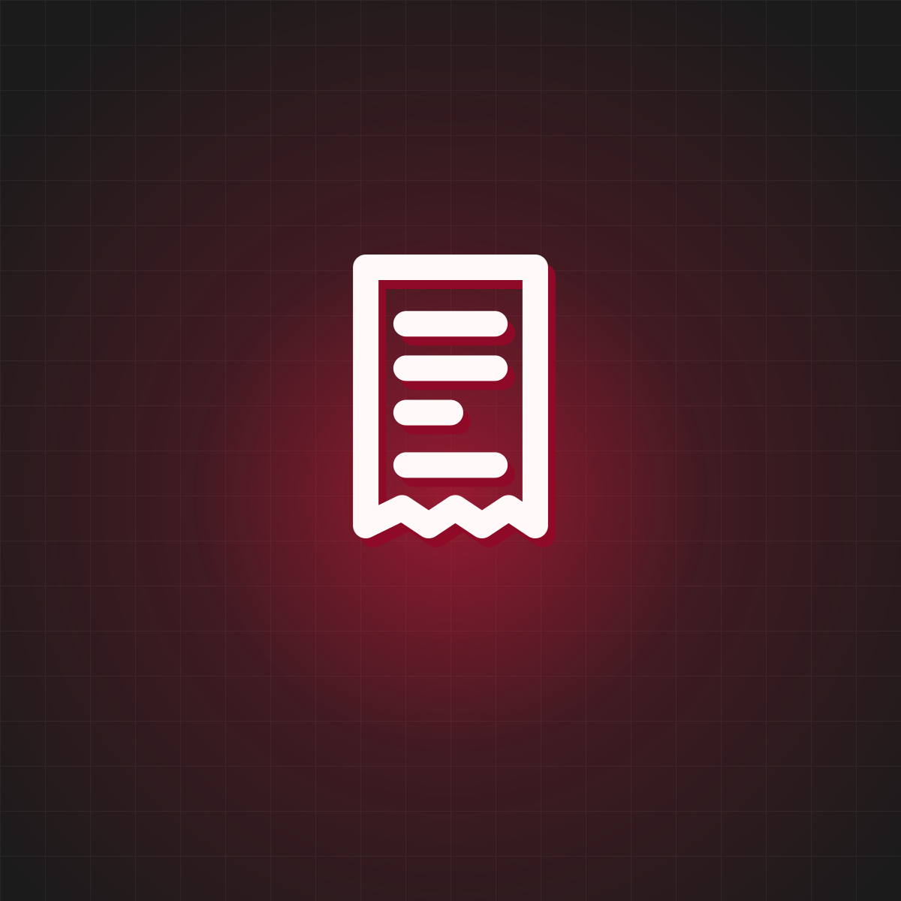

# ByteX website — editing guide

Written for beginners. Every change follows the same loop:

1. Open the file in a code editor (for example VS Code).
2. Change one thing and save.
3. Refresh the browser. If nothing changes, do a hard refresh
   (`Ctrl + Shift + R`, or `Cmd + Shift + R` on a Mac).

**Tip:** in `index.html`, search (`Ctrl + F`) for `EDIT` to jump between
editable spots, or for `START:` to jump between sections.

---

## 1. Section map

All sections are in `index.html`, in this order. Search for the text in the
"Find it" column.

| # | Section (on screen) | Find it | What you can change | Also update |
| --- | --- | --- | --- | --- |
| – | Browser tab | `<title>` | Tab title, `meta name="description"` | – |
| – | Loading screen | `START: Loading screen` | The word `bytex` in `.load-text` | – |
| – | Header | `START: Header` | Logos, menu labels and links | Menu labels exist **twice**: desktop menu **and** full-screen/mobile menu |
| – | Full-screen menu side panel | `Menu side panel` | Intro text, image, location, email, website, social links | Same contact details are in the footer |
| 1 | Hero | `START: Hero section` | Headline, four tags, rotating circle words, intro, button | – |
| 2 | Solutions (horizontal cards) | `START: Solutions` | 8 cards: image, tags, title, link; final pink card | Keep "(proposed)" on planned tools |
| 3 | About | `START: About` | Label and statement | – |
| 4 | Services | `START: Services` | Heading, three cards (title, text, button) | – |
| 5 | Moving words | `START: Moving words (marquee) under Services` | Five words | Change them in **both** tracks |
| 6 | Team | `START: Team` | Small round images, heading, intro, mission box, button, three numbers | Panel image is in `bytex.css` (section 7) |
| 7 | Approach | `START: Approach` | Big title, five cards (icon, title, text) | – |
| 8 | Vision & purpose | `START: Vision & purpose` | Three statements with images; four value words | Preview images must match the statements' order |
| 9 | Moving words | `START: Moving words above the leadership list` | Words | Both tracks |
| 10 | Founding leadership | `START: Founding leadership` | Number, name, role, hover image | Team intro text mentions "five" leads |
| 11 | Roadmap | `START: Roadmap` | Heading, six priority cards | – |
| 12 | Footer / contact | `START: Footer / Contact` | Headline, email button, logo, motto, contact line, footer links, socials, updates form text | Menu side panel has the same contact details |

---

## 2. Change text

Change only the words between the tags. Keep the tags and their classes.

```html
<!-- before -->
<h2 class="mil-title"><span> <span class="opacity-7 d-inline">Our</span> initial services. </span></h2>

<!-- after -->
<h2 class="mil-title"><span> <span class="opacity-7 d-inline">Our</span> services. </span></h2>
```

- The inner `<span class="opacity-7 ...">` makes that word lighter. Keep it if
  you want the effect.
- `<br>` forces a line break.
- Write `&amp;` for an `&` character inside text.
- Longer text can change how lines wrap. Check desktop **and** phone sizes.

---

## 3. Change logos

Logo files are in `assets/images/brand/`.

| Where | Theme | File | Class (keep it) |
| --- | --- | --- | --- |
| Header | Dark | `bytex-logo-white-transparent.png` | `logo-light` |
| Header | Light | `bytex-logo-red-transparent.png` | `logo-dark` |
| Footer | Dark | `bytex-logo-red-transparent.png` | `logo-light` |
| Footer | Light | `bytex-logo-red-transparent.png` | `logo-dark` |
| Menu side panel | Both | `bytex-logo-red-panel.jpg` | – |
| Team image panel | Both | `bytex-logo-white-panel.jpg` (set in `bytex.css`) | – |
| Browser tab icon | Both | `favicon-32.png`, `favicon-192.png` | – |
| Phone home-screen icon | Both | `apple-touch-icon.png` | – |

The class names are confusing, so remember: **`logo-light` = the logo shown on
the dark theme** (a light-coloured logo); **`logo-dark` = the logo shown on
the light theme**.

To replace a logo, either overwrite the file with a new file of the **same
name**, or add a new file and change the `src`. Use a PNG with a transparent
background for the header and footer. The header logo width is set in `bytex.css`
(section 4); the footer logo width comes from `template.css` (150px). Logos
keep their proportions automatically.

---

## 4. Change colors

Open `assets/css/bytex.css`. The first block is the whole palette:

```css
:root {
  --bytex-pink: #FD1843;          /* True Pink */
  --bytex-chill-white: #FFF9FA;   /* Chill White */
  --bytex-dark: #161616;          /* dark theme background */
  --bytex-ink: #111012;           /* dark text */
  --bytex-text-on-pink: #161616;  /* text placed on pink */
}
```

Change a value and save; every pink button, card, underline and focus ring
updates. Keep the variable names. After changing colors, check **both**
themes with the moon/sun button, and keep text readable (dark text on pink
is used because white text on this pink is too low-contrast for small text).

The illustrations in `assets/images/artwork/` contain the colors written
inside each SVG file (`#FD1843`, `#FFF9FA`). To recolour them, open an SVG in
a text editor and replace those values.

---

## 5. Change images

1. Put the new image in the right folder (`assets/images/artwork/` for
   illustrations; create `assets/images/team/` for photos).
2. Change the `src` (or the `url(...)` path for background images).
3. Update `alt` to describe the image. Use `alt=""` only for purely
   decorative images.

```html

```

Names are case-sensitive: `Photo.JPG` and `photo.jpg` are different files.

| Image | Where | Recommended shape |
| --- | --- | --- |
| Solutions cards | `img` in each `SOLUTION CARD` | Square, subject in the middle (cards crop to fit) |
| Vision statements | `img` in each `STATEMENT` **and** the matching preview slide | Portrait, about 4:5 |
| Roadmap cards | `img` in each `PRIORITY` | Landscape, about 3:2 |
| Leadership hover images | `background-image: url('...')` in each `LEADER` row | Portrait |
| Team round images | `img` inside `.user-imgs` | Square |
| Team image panel | `bytex.css`, section 7 | Landscape 3:2 |
| Hero background patterns | `background-image` in the Hero section | Keep the originals unless redesigning |

---

## 6. Edit navigation and links

`href` controls where a link goes:

- `#about` scrolls to the element with `id="about"` on this page.
- `mailto:bytex.my@gmail.com` opens the visitor's email app.
- `https://...` opens another website (add `target="_blank" rel="noopener noreferrer"` to open it in a new tab).

Section IDs on this page: `top`, `home`, `solutions`, `about`, `services`,
`team`, `approach`, `vision`, `leadership`, `roadmap`, `contact`.

**Renaming a menu item:** change it in **both** menus.

```html
<!-- Desktop menu (search: Desktop navigation) -->
<a class="nav-link dropdown-toggle" href="#about"><span class="rolling-text">About</span></a>

<!-- Full-screen / mobile menu (search: Full-screen / mobile menu) -->
<a class="link dmenu dmenu-children" href="#about"><span class="fill-text" data-text="About">About</span><i></i></a>
```

In the full-screen menu, `data-text` must match the visible label.

**Adding a submenu link:** copy one `<li>...</li>` inside the matching
`<ul class="sub-menu ...">`, in both menus.

**If you change a section's `id`,** update every link that points to it
(search for `#oldname`) and the list at the bottom of `bytex.css`
(section 12), which keeps sections from hiding under the header.

### Social links

They appear in two places: the full-screen menu side panel and the footer
(search `SOCIAL ICONS`). Currently:

- **Instagram:** `https://www.instagram.com/bytex.my/` (built from the
  handle `@bytex.my` in the brief — please confirm it opens the right profile).
- **Email:** `mailto:bytex.my@gmail.com`.
- **Facebook:** prepared but **switched off**, because the brief gives the page
  name "ByteX" but no link. In the footer, find `FACEBOOK (disabled)`, delete
  the `<!--` line above the block and the `-->` line below it, and replace
  `PASTE-FACEBOOK-PAGE-URL-HERE` with the exact page URL. Add a matching
  `<li>` in the menu side panel too.

---

## 7. Add or edit cards

Always copy a **complete** block, from its opening tag to its matching closing
tag, and paste it next to the original. Never duplicate an `id`.

**Solutions card:** copy one `SOLUTION CARD` block (the whole
`<div class="item-panel ...">`). Keep the final pink "Start a project" card
last. The sideways-scrolling effect adjusts to any number of cards.

**Service card:** the three services use fixed layout columns. Edit the
existing three rather than adding a fourth.

**Approach card:** edit the five existing cards. Their `offset-lg-...`
classes create the staggered layout, so keep them in place.

**Vision statement:** copy one `swiper-slide` in `.main-slider` **and** one in
`.thumb-slider`, keeping both lists in the same order. The "1 / 3" counter
updates automatically.

**Roadmap card:** copy one `PRIORITY` `swiper-slide`. The slider counts cards
automatically.

**Moving words:** each marquee has two identical tracks. Make the same change
in both.

---

## 8. Update team profiles

**Leadership list** (search `START: Founding leadership`). Each person is one
`LEADER` block:

```html
<span class="award-year">02</span>
<span class="award-text">Md Ismayel Shekh</span>
...
<span class="award-position">Development Head</span>
...
<div class="award-reveal-img bg-img" style="background-image: url('assets/images/artwork/role-development.svg');"></div>
```

- To add a photo: put it in `assets/images/team/` (portrait works best) and
  change the `url(...)` path.
- To add a person: copy a whole `LEADER` block and change the number.
- If the number of leads changes, also update: the team intro ("led by five
  AIU students"), the `+2` circle and its `aria-label`, and the "founding
  leads" number in the Team section.
- Student ID numbers are intentionally not shown.

**Small round images** at the top of the Team section show role icons. Replace
each `src` with a square photo and set `alt` to the person's name.

---

## 9. The "Get updates" form

The form is frontend-only (see README). Its texts:

- Heading: search `Get updates`.
- Note under the field: search `newsletter-note`.
- Messages shown after pressing the arrow, the email address and the draft
  subject: `assets/js/main.js`, in `SETTINGS` and `showNewsletterMessage()`.

Keep the ids `newsletter-form`, `newsletter-email` and `newsletter-status`.

---

## 10. Avoid breaking animations and mobile layouts

- **Keep classes, ids and `data-...` attributes.** Scripts use these, among
  others: `hr-container`, `item-panel`, `hamenu`, `navbar-menu-btn`,
  `close-menu`, `dmenu-children`, `theme-icon`, `logo-light`, `logo-dark`,
  `main-slider`, `thumb-slider`, `swiper-*`, `blog-style2`, `awards-reval`,
  `hover-reveal-item`, `award-reveal-img`, `features`, `stack-title`,
  `rolling-text`, `hero-animate`, `load-text`, `data-ui-animate`, and the ids
  `smooth-wrapper`, `smooth-content`, `svg`.
- **Do not remove the layout wrappers** (`layout-block`, `layout-inner`,
  `widget`, `widget-content`). They hold the template's spacing.
- **Keep the script order** at the bottom of `index.html`: libraries first,
  `main.js` last.
- **Put new styles at the end of `bytex.css`.** Use a section id to make them
  specific, for example `#services .h4 { ... }`.
- **After each change, check:** a phone-sized window (browser developer tools
  → device toolbar), both themes, the menu button and both sliders.
- `data-ui-animate` on an element makes it fade in on scroll. Remove the
  attribute to stop that element animating.

---

## 11. Missing content to supply

| Item | Where it goes | Current state |
| --- | --- | --- |
| Photos of the five founding leads | Leadership hover images; Team round images | Role-icon illustrations used instead |
| Facebook page URL | Footer social icons and menu side panel | Prepared but switched off |
| Confirmation of Instagram profile | Footer and menu | `instagram.com/bytex.my`, built from `@bytex.my` |
| Whether www.bytex.my is live | Menu side panel link | Linked as given in the brief |
| Color reference file | – | Not included in the upload; colors use the True Pink `#FD1843` and Chill White `#FFF9FA` values from the instructions |
| Real project examples | Solutions or a future projects section | None shown; no projects are claimed |
| Privacy policy | Needed before collecting any personal data | Not needed yet, because the form saves nothing |

No testimonials, clients, awards, prices or statistics have been invented.
The three numbers in the Team section (5 founding leads, 2 initial service
areas, 6 short-term priorities) come from the brief.
